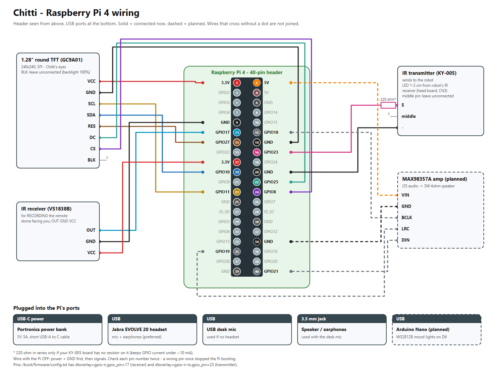

# Chitti — an AI desk robot

A toy Silverlit robot turned into a talking desk companion. A Raspberry Pi 4 rides on its back and gives it:

- **Eyes:** two animated eyes on a 1.28" round screen behind the visor. They blink and glance, and show moods (happy, sad, angry, thinking…) plus emoji reactions (hearts, music notes, Zzz, star eyes…). When nobody talks to it, Chitti gets playful, then drowsy, and falls asleep.
- **Ears:** "Hey Chitti" wake word (sherpa-onnx keyword spotter, no training) and offline speech-to-text (faster-whisper).
- **Brain:** Claude, through the Anthropic API. It can choose expressions, move, dance, and shut down or restart by voice (after asking you to confirm).
- **Voice:** offline text-to-speech (Piper), in English and Telugu.
- **Legs:** the robot's own wheels, driven by replaying its infrared remote's signals from the Pi.

<!-- Add a hero photo here once it's taken:  -->

## Hardware

| Part | Used for |
|---|---|
| Silverlit robot (~40 cm, IR remote, wheels) | body and movement |
| Raspberry Pi 4 Model B, 4 GB + 64 GB microSD | everything |
| 1.28" GC9A01 round TFT, 240×240, SPI | eyes |
| VS1838B IR receiver | recording the remote (once) |
| KY-005 IR transmitter | sending to the robot |
| Jabra EVOLVE 20 USB headset / USB mini mic | listening (and speaker) |
| Portronics 10,000 mAh power bank, 5V 3A | power |
| *Planned:* MAX98357A I2S amp + 3W speaker, Arduino Nano + WS2812B LEDs | built-in voice, mood lights |

**Wiring:** see [docs/wiring.md](docs/wiring.md).



## Software layout

```
pi/
  app/          chitti.py (main loop), ears.py (wake word + STT), brain.py (Claude + tools),
                mouth.py (Piper TTS), face.py (eyes, idle life), robot.py (IR movement, power), config.py
  display/      gc9a01.py (driver), eyes.py, emoji.py, boot_screen.py, *-preview.png
  ir/           record.sh / send.sh (record and replay the remote)
  chitti.service, setup-*.sh   (systemd service + one-time root setup scripts)
docs/           wiring diagram and guide
tools/          make_wiring_svg.py (draws docs/wiring.svg)
photos/         teardown, parts and build photos
chitti-robot-build-plan.md     the full build log: decisions, measurements, tuning
```

## Setting it up

On Raspberry Pi OS Lite 64-bit (Trixie): copy `pi/` to `~/chitti/` on the Pi, then from that folder:

1. `sudo bash setup-system.sh`: IR overlays, packages, Python venv.
2. `sudo bash setup-display.sh`: SPI and display libraries.
3. Put your Anthropic API key in `~/chitti/.env` as `ANTHROPIC_API_KEY=...`, then `chmod 600` it. **Never commit this file.**
4. `sudo bash setup-chitti-service.sh`: starts Chitti at boot.
5. `sudo bash setup-power.sh`: lets Chitti shut down when you ask it to.
   Then `bash setup-wake-word.sh` (no sudo): installs the "Hey Chitti" wake word.
   Optional: `sudo bash setup-bluetooth.sh` for a Bluetooth speaker (then pair it, and copy `asoundrc-bluetooth` to `~/.asoundrc`).
6. Record the robot's remote: see [docs/wiring.md](docs/wiring.md#recording-and-testing-the-remote).

Logs: `journalctl -u chitti -f`. Run by hand (after `sudo systemctl stop chitti`): `~/chitti/venv/bin/python ~/chitti/app/chitti.py --debug`.

## Photos

Teardown and build photos are in [photos/](photos/).
