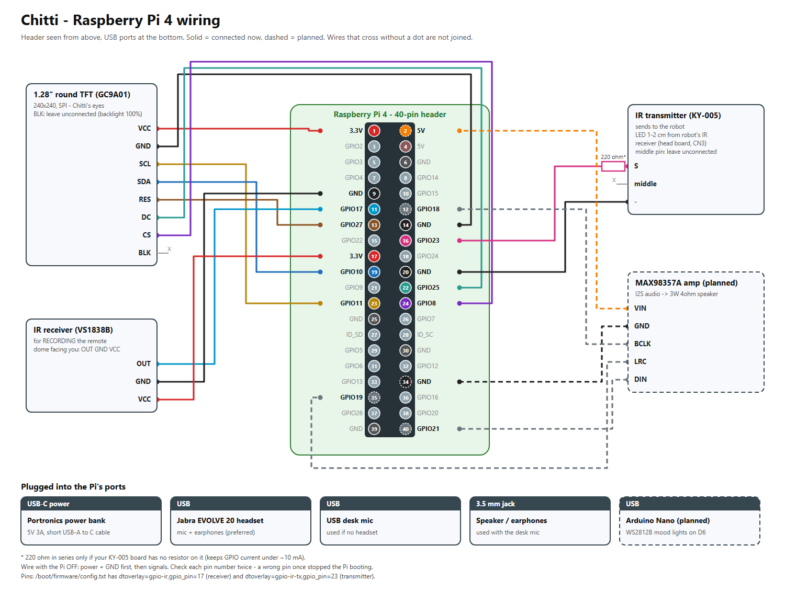

# Chitti wiring

The diagram is generated from `tools/make_wiring_svg.py` (edit the `CONNECTIONS` list and re-run it). The SVG version is [wiring.svg](wiring.svg).

**Always wire with the Pi off.** Connect power and GND first, then the signal wires. Count pins from **pin 1**, the corner pin nearest the SD card end, which has a square pad underneath. Odd pins are on the inside row, even pins on the board-edge row.

## Pin map

| Pi pin | Name | Goes to | Status |
|---|---|---|---|
| 1 | 3.3V | TFT VCC | connected |
| 2 | 5V | MAX98357A VIN | planned |
| 9 | GND | IR receiver GND | **IR (new)** |
| 11 | GPIO17 | IR receiver OUT | **IR (new)** |
| 12 | GPIO18 | MAX98357A BCLK | planned |
| 13 | GPIO27 | TFT RES | connected |
| 14 | GND | TFT GND | connected |
| 16 | GPIO23 | KY-005 S (IR LED) | **IR (new)** |
| 17 | 3.3V | IR receiver VCC | **IR (new)** |
| 19 | GPIO10 (SPI MOSI) | TFT SDA | connected |
| 20 | GND | KY-005 − | **IR (new)** |
| 22 | GPIO25 | TFT DC | connected |
| 23 | GPIO11 (SPI SCLK) | TFT SCL | connected |
| 24 | GPIO8 (SPI CE0) | TFT CS | connected |
| 34 | GND | MAX98357A GND | planned |
| 35 | GPIO19 | MAX98357A LRC | planned |
| 40 | GPIO21 | MAX98357A DIN | planned |
| 15 | GPIO22 | (TFT BLK, left unconnected) | free |

USB: Jabra EVOLVE 20 headset (preferred), USB desk mic (fallback, speaker on the 3.5 mm jack), Arduino Nano (planned). Power: USB-C from the Portronics power bank.

## IR wiring map

Two IR parts. The **receiver** is only for recording the toy's remote once. The **transmitter** stays in the robot and sends those codes.

### 1. IR receiver (VS1838B, loose 3-pin) for recording

Hold it with the dome facing you and the legs down. The legs are, left to right: **OUT, GND, VCC**.

| Receiver leg | Wire | Pi pin |
|---|---|---|
| OUT (left) | blue | **11** (GPIO17) |
| GND (middle) | black | **9** (GND) |
| VCC (right) | red | **17** (3.3V) |

Use **3.3V, never 5V**. The OUT signal goes straight into a GPIO, and 5V would damage it. If your part has a printed board with labels (KY-022), follow the labels: `S` goes to pin 11, `−` to pin 9, and the middle pin to pin 17.

### 2. IR transmitter (KY-005) for sending

| KY-005 pin | Wire | Pi pin |
|---|---|---|
| S | pink, through a 220 Ω resistor* | **16** (GPIO23) |
| middle | leave unconnected | — |
| − | black | **20** (GND) |

\* Look at the KY-005 board. If it has **no** resistor on it (only the LED), put a 220 Ω resistor in the S wire. That keeps the GPIO current around 9 mA. If there is a small resistor on the board, wire S directly.

**Placement in the robot:** the robot's IR receiver is the 3-pin part on the edge of the head's LED board (CN3, behind the visor). Point the KY-005 LED at it from **1–2 cm** away. For recording, the remote doesn't need to be inside the robot; any distance up to about 30 cm in front of the Pi's receiver works.

## Recording and testing the remote

Already set up on the Chitti card: both overlays in `/boot/firmware/config.txt`, `ir-ctl` installed, and the scripts in `~/chitti/ir/`. Linux numbers the two devices `/dev/lirc0` and `/dev/lirc1`, and that order can change between boots. The scripts and `app/robot.py` therefore pick the right device by asking each one what it can do.

1. Shut the Pi down (`sudo shutdown -h now`), wire the receiver and transmitter as above, then power on.
2. Stop Chitti so it doesn't use the IR devices: `sudo systemctl stop chitti`
3. Record every button: `bash ~/chitti/ir/record.sh`
   It asks for forward, back, left, right, slide_left, slide_right, stop and dance in turn. Press Enter, then tap that button **once**. Keep the remote's channel switch where it is.
   To redo one button: `bash ~/chitti/ir/record.sh forward`
4. Test with the robot switched on and the IR LED pointing at its receiver: `bash ~/chitti/ir/send.sh forward 5`
5. Start Chitti again: `sudo systemctl start chitti`. "Hey Jarvis, move forward" now really moves the robot.

If the robot ignores the replay: move the LED closer or aim it better, try more repeats (`send.sh forward 15`), or check the recording has a sensible number of pulses. `record.sh` prints the count; a typical button gives 30–100.
